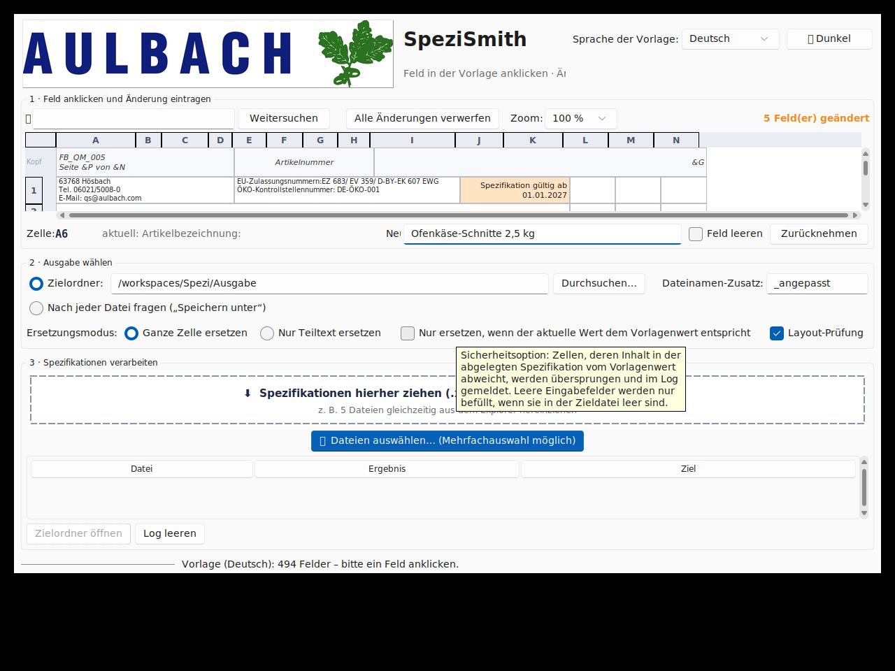

# SpeziSmith 🥄📄

**Spezifikationen (FB_QM_005 Produktspezifikation / Product Specification) komfortabel
anpassen** – als portable Windows-EXE, die ohne Installation überall läuft
(USB-Stick, Festplatte, Netzlaufwerk).



## Was macht das Tool?

1. **Vorlage hochladen:** SpeziSmith startet ohne Vorlage. Über **„Vorlage
   hochladen“** (Button oder Drag & Drop) lädt man eine einmal korrekt gebaute
   Spezifikation (z. B. mit Revision 003) hoch; das Tool analysiert alle Felder
   samt Beschriftung. Beliebige Sprache/Variante – es gibt keine feste Vorlage.
2. **Die Vorlage als ganze Seite sehen:** SpeziSmith zeigt sie
   **maßstabsgetreu wie im Ausdruck** an: beide Teile (Produkt- *und* Verpackungsspezifizierung),
   **Kopf- und Fußzeile** (z. B. „FB_QM_005 · Seite &P von &N“, Datum/Revisionsnummer),
   Seitenumbruch-Linien, Spaltenbreiten, Zeilenhöhen, verbundene Zellen und Farben.
   Man klickt **einfach genau das Feld an**, das man ändern will, und trägt unten
   den neuen Wert ein – oder wählt **„Vorlagenwert in alle Spezifikationen
   übernehmen“** (z. B. für die Revisionsnummer). Die Änderung wird sofort farblich hervorgehoben direkt
   im Seitenlayout sichtbar (WYSIWYG). Mit dem **Zoom-Regler** (60–150 %) passt
   die ganze Seite auf den Bildschirm.
3. **Spezis hereinziehen:** Eine oder **mehrere Spezifikationen gleichzeitig**
   (z. B. 5 markierte Dateien) in die Drag-&-Drop-Zone ziehen. Alle geänderten
   Felder werden gegen die Vorlage ersetzt. **Fehlt ein Feld in der Spezi**,
   wird es an der passenden Stelle (anhand der Zeilen darüber) als neue Zeile
   eingefügt – so gibt es keine „Feldsprünge“. Das Ergebnis landet wahlweise
   - in einem **Zielordner** (Pfad eingeben/durchsuchen) oder
   - per **„Speichern unter“-Dialog** („Download“-Gefühl) für jede Datei.

Das Firmenlogo, alle Formatierungen, VML-/ActiveX-Elemente und Druckeinstellungen
bleiben dabei **vollständig erhalten** (die Ersetzung erfolgt direkt auf
XML-Ebene, kein verlustbehafteter Excel-Roundtrip).

## Weitere Features

- 🧭 **Verschiebungstolerante Ersetzung:** Zellen werden über ihren **Inhalt**
  bzw. über die **Beschriftung neben dem Feld** gefunden – funktioniert auch,
  wenn eine Spezifikation mehr Zutaten-Zeilen hat als die Vorlage und sich
  alles verschoben hat
- 🛡️ **Layout-Prüfung** (empfohlen, abschaltbar): Dateien, deren Aufbau deutlich
  von der Vorlage abweicht, werden übersprungen statt falsch befüllt
- 📄 **Kopf- und Fußzeile wählbar** (Dokumentnummer, Seitenzahlen, Datum,
  Revisionsnummer …); Format- und Feld-Codes (&P/&N/&G) bleiben erhalten
- 🔎 **Suche** über Zelle und Inhalt, springt per Enter durch alle Treffer
- ✏️ Änderungen direkt in der Seitenansicht sichtbar; pro Feld auch
  **„Feld leeren“** oder **„Zurücknehmen“** möglich
- ☑️ Zählwerk „x Felder geändert“ und „Alle Änderungen verwerfen“
- 🔍 **Zoom** 60–150 % für die Ganzseiten-Ansicht
- ✍️ Zwei Ersetzungsmodi: **ganze Zelle** oder **Teiltext** (z. B. Datum im Kopf)
- 🛡️ Optionale Verifikation: nur ersetzen, wenn der Ist-Wert dem Vorlagenwert
  entspricht (leere Felder werden nur befüllt, wenn sie im Ziel leer sind)
- 🌙 Hell/Dunkel-Theme
- 💾 Einstellungen werden portabel in `spezismith_config.json` **neben der EXE**
  gespeichert – ideal für den USB-Stick
- 📊 Fortschrittsbalken und Restzeitschätzung bei länger laufenden Stapeln
  (der Balken erscheint nach kurzer Wartezeit; bei einer einzelnen Datei läuft
  er animiert); dazu farbiges Ergebnis-Log (Doppelklick öffnet Zielordner)

## Die fertige EXE erhalten

### Variante A – automatisch über GitHub Actions (empfohlen)

1. Repo zu GitHub pushen
2. Tab **Actions** → Workflow *„SpeziSmith EXE bauen“* → **Run workflow**
3. Nach ~2 Minuten liegt `SpeziSmith.exe` als **Artefakt** zum Download bereit

### Variante B – lokal unter Windows bauen

Voraussetzung: [Python 3.12+](https://www.python.org/downloads/) (im Installer
„Add python.exe to PATH“ aktivieren). Dann im Projektordner:

```
build_exe.bat
```

→ fertige, in sich geschlossene `dist\SpeziSmith.exe` (~20 MB), die man überallhin
kopieren kann.

## Bedienung im Detail

| Schritt | Aktion |
|---|---|
| 1 | **Vorlage hochladen** → Feld anklicken → „in alle Spezifikationen übernehmen“ oder neuen Wert eintragen (Suche hilft beim Finden) |
| 2 | Zielordner angeben *oder* „Nach jeder Datei fragen“; Dateinamen-Zusatz (Standard `_angepasst`); optional Verifikation/Teiltext-Modus |
| 3 | `.xlsx`-Dateien in die Drop-Zone ziehen (Mehrfachauswahl!) oder über die Schaltfläche auswählen |

Eigene (neuere) Vorlagenversionen lassen sich nutzen, indem die Dateien unter
`templates\` ersetzt werden – der Aufbau wird bei jedem Start neu analysiert.

## Entwicklung

```
pip install -r requirements.txt -r requirements-dev.txt
python main.py                    # GUI starten
python -m pytest tests/ -q        # Engine-Tests (15 Tests)
xvfb-run python scripts/smoke_gui.py   # GUI-Smoke-Test (Linux)
python scripts/make_assets.py     # Logo/Icon neu erzeugen
```

### Projektstruktur

```
├── main.py                  # Einstieg / PyInstaller-Ziel
├── spezismith/
│   ├── engine.py            # Analyse, Spracherkennung, XML-sicheres Ersetzen,
│   │                        # Anker-Auflösung, Kopf-/Fußzeile, Layout-Prüfung
│   ├── sheetview.py         # klickbare WYSIWYG-Ganzseitenansicht mit Zoom
│   ├── gui.py               # Oberfläche (ttk + Sun-Valley + DnD)
│   └── resources.py         # Pfade, portable Konfiguration
├── templates/               # eingebettete Vorlagen (DE/EN)
├── assets/                  # Logo, Icon, Screenshots
├── tests/                   # Engine-Tests mit den echten Vorlagen
├── scripts/                 # Asset-Generator, Smoke-Tests
└── build_exe.bat            # Windows-Build
```

## Technischer Hinweis zum Logo

Das Firmenlogo (`assets/logo.jpeg`, extrahiert aus der Vorlage) liegt in jeder
erzeugten Spezifikation wieder bei: Die Engine kopiert beim Schreiben alle
ZIP-Bestandteile der Originaldatei **byte-identisch** und verändert nur die
Zellinhalte im Tabellenblatt-XML.